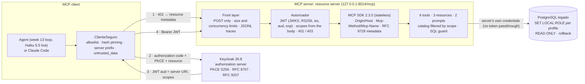

# Week 14: remote MCP server with OAuth, least privilege and tool-poisoning tests

Status: complete. Activities 1 to 9 are done, and exit criterion 14 is verified (section 7).

Phase 4 (weeks 13 to 18) covers agents, MCP and orchestration. Week 13 built an agent over the LegacyBridge legacy schema and an MCP server over stdio. This week turns that server into a **remote MCP server**:
- **Protocol:** MCP 2026-07-28 over Streamable HTTP.
- **Authorization:** OAuth 2.1, with the server acting only as a resource server.
- **Least privilege** in three layers (scopes, filtered catalogs, a PostgreSQL role per profile).
- **Security:** a 13-threat model, a secure client against tool poisoning, and an agent evaluation in CI.

Everything runs on `127.0.0.1` and in GitHub Actions: no cloud resources. The only cost is the Anthropic API, **$0.92 for the whole week** (section 6).

## 1. Architecture



| Component | Code | What it does |
|---|---|---|
| Client | [`cliente/seguro.py`](cliente/seguro.py), [`auth/pkce.py`](auth/pkce.py) | Gets a token per user (authorization code + PKCE + `resource`), connects only to allowlisted servers whose tools match the approved hashes, prefixes tools by server (`legado__ejecutar_sql`) and wraps every result as untrusted data |
| Authorization server | [`auth/`](auth/) (Keycloak in Docker, realm [`legacybridge`](auth/realm/legacybridge-realm.json)) | 3 users, 4 scopes tied to roles, public client with PKCE S256 and loopback redirects, audience bound to the server's canonical URI, refresh-token rotation. No secrets in Git: [`arrancar.sh`](auth/arrancar.sh) generates them |
| Resource server | [`servidor/http.py`](servidor/http.py), [`servidor/oauth.py`](servidor/oauth.py), [`servidor/primitivas.py`](servidor/primitivas.py) | Validates the JWT on every request, decides the required scopes from the body (not from headers), filters `tools/list`, `resources/list` and `prompts/list` by scope, and answers 401 or 403 `insufficient_scope` with a step-up challenge |
| Database | [`auth/roles_bd.sql`](auth/roles_bd.sql), week 13 guard | One PostgreSQL role per scope combination, with column grants (`artmst.art_prv` and `art_cst` only with `legado:proveedores`). The token never reaches the database |

## 2. Scope × tool × view matrix

Source of truth: [`auth/permisos_oauth.json`](auth/permisos_oauth.json). The server derives everything from the token's scopes, never from the user name or the tool arguments.

| Scope | Tools | Views and columns | Resources and prompts |
|---|---|---|---|
| `legado:leer` (base, required for any call) | `describir_esquema`, `buscar_regla_negocio`, `muestrear_valores`, `validar_sql`, `ejecutar_sql` | `almmst`, `artmst` **without** `art_cst` and `art_prv`, `exidet`, `artnot` | `legado://manifiesto`, `legado://reglas/{id}`, `legado://esquema/{vista}` for these views; prompt `analizar_exceso_inventario` |
| `legado:ventas` | — | `vtadia` | `legado://esquema/vtadia` |
| `legado:proveedores` | — | `prvmst`, `ocpcab`, `artmst.art_prv` (supplier FK), `artmst.art_cst` (cost) | their schema resources |
| `legado:compras:proponer` | `proponer_orden_compra` (records a `PENDING_APPROVAL` proposal, never runs it) | — | prompt `proponer_reabasto` (also needs cost and supplier) |

| Profile | Scopes Keycloak can grant | Tools | Views | PostgreSQL role |
|---|---|---|---|---|
| `analista` | all four | 6 | 7 | `legado_perfil_lvp` |
| `almacenista` | `legado:leer` | 5 | 4 | `legado_perfil_l` |
| `vendedor` | `legado:leer`, `legado:ventas` | 5 | 5 | `legado_perfil_lv` |

A client that requests fewer scopes gets less: Claude Code asks only for what the server advertises (`legado:leer`), so even `analista` was denied supplier data in the manual test ([`resultados/claude_code.md`](resultados/claude_code.md)).

The week 13 finding is closed: the foreign key `artmst.art_prv` revealed the supplier to a role without supplier access. It now counts as a supplier column in the guard and in the database grants (A05).

## 3. Threats and tests

Full matrix: [`seguridad/amenazas.md`](seguridad/amenazas.md). **13/13 threats covered**, each with its mitigation and the tests that prove it.

| ID | Threat | Main mitigation | Proven by |
|---|---|---|---|
| A01 | Tool poisoning (hidden instructions in descriptions) | Server allowlist; descriptions are never orders | client tests; agent eval |
| A02 | Rug pull | Hash pinning against `legado://manifiesto`; the server is blocked on any change | client tests; agent eval |
| A03 | Tool shadowing | Server prefix; duplicate names rejected | client tests; agent eval (without defenses, 100% of queries went to the shadow) |
| A04 | Indirect injection through data and rules | Results marked and wrapped as untrusted data; read-only role | agent eval |
| A05 | Confused deputy | Permissions from the token; DB role per profile; FK `art_prv` restricted | `test_auth.py`; agent eval |
| A06 | Token passthrough | `aud` must be the server URI; the token is never forwarded or logged | `test_auth.py` |
| A07 | Token theft or wrong audience | 5-minute tokens, JWKS signature, fixed RS256, exact `iss` and `aud` | `test_auth.py`, `test_keycloak.py` |
| A08 | DNS rebinding | Bind to `127.0.0.1`; `Origin` and `Host` checked | `test_transporte.py` |
| A09 | Leak across roles and tenants | Filtered catalogs; 403 `insufficient_scope`; DB roles; other tenants' tables denied | `test_auth.py`; agent eval |
| A10 | Unapproved write | DB role without writes, READ ONLY + rollback, SQL guard, proposals only | database fingerprint in every eval |
| A11 | Header and body mismatch | SDK `-32020`, plus the case the SDK misses (version header vs `_meta`) | `test_transporte.py` |
| A12 | SSRF and mix-up during discovery | Expected issuer only, loopback-only `http`, exact metadata | client tests |
| A13 | Denial of service and cost | Body, concurrency, time and row limits; agent loop limits; CI cost cap | `test_transporte.py`; agent eval |

**Tests without API** ([`tests/`](tests/)): **173 passed, 0 skipped** both in CI (Postgres plus an ephemeral Keycloak per job) and on the dev Mac. They cover the SDK baseline (24 checks), primitives and equivalence with week 13, HTTP transport, Keycloak (19), OAuth and negative auth (43: missing, expired, other-issuer, other-audience, altered-signature, `alg: none` tokens, insufficient scope, unlisted tool, escalation through arguments), the secure client (26) and the eval harnesses.

## 4. Results

| Activity | Result | Evidence | PR |
|---|---|---|---|
| 1. Baseline | Spec 2026-07-28 is current; SDK `mcp` 2.3.0 passes 24/24 checks; 4 gaps identified and built during the week; 13-threat model | [`linea_base.md`](resultados/linea_base.md) | #85 |
| 2. Primitives | 6 tools with `outputSchema` and annotations, 3 resources (2 templates), 2 prompts filtered by permissions; outputs identical to week 13 | [`primitivas.md`](resultados/primitivas.md) | #86 |
| 3. Streamable HTTP | Stateless server on `127.0.0.1` with size, concurrency and time limits and JSONL traces; HTTP = stdio = in-memory | [`transporte.md`](resultados/transporte.md) | #88 |
| 4. Keycloak | Realm with RFC 8707 audience, PKCE S256, scopes by role, idempotent start script | [`keycloak.md`](resultados/keycloak.md) | #89, #90 |
| 5. Resource server | JWT validation, 401/403 with step-up, catalogs and DB role by scope; the `row_to_json` guard bypass from week 13 found and closed | [`oauth.md`](resultados/oauth.md) | #91 |
| 6. Tool poisoning | With defenses **38/38**, 0 instructions obeyed, 0 writes, 0 leaks. Without defenses, shadowing captured 100% of the agent's SQL | [`poisoning.md`](resultados/poisoning.md), [`seguridad.md`](resultados/seguridad.md) | #92 |
| 7. Agent against the remote server | Remote **0.900**, stdio 0.900, in-process (week 13) 0.917 on 20 tasks × ES/EN: same 4 failures, same cost per task. HTTP + OAuth adds **+7 ms p50 per tool call** (< 1% of task time). Role without the scope: **0/8 leaks** | [`agente_remoto.md`](resultados/agente_remoto.md), [`remoto.md`](resultados/remoto.md) | #93 |
| 7 (optional). Claude Code | Claude Code discovers Keycloak from the server, signs in with PKCE, gets only `legado:leer`, answers through the server and is denied supplier data; token refresh works | [`claude_code.md`](resultados/claude_code.md) | #94 |
| 8. CI | `eval-semana-14`: Postgres + ephemeral Keycloak; tests without API; agent mini eval (10 tasks × ES/EN × k = 2 + 38 poisoning cases); thresholds ES 0.90 / EN 0.90; cost cap $0.40 per run. 3 green runs | [`ci.md`](resultados/ci.md) | #95 |

### Findings worth keeping

1. **Shadowing is the attack the model cannot stop.** If two servers publish `ejecutar_sql`, a naive client sends every query to the last one registered. Only the client's prefix and allowlist bring that to 0.
2. **MCP authorization protects nothing if the client has another way to the data.** In the first manual test, Claude Code answered from a direct database connection instead of the MCP server. The test had to isolate the client (`--strict-mcp-config`, no shell or file tools).
3. **Keycloak 26.8 loses the RFC 8707 audience when it refreshes an offline token**, and Claude Code always asks for `offline_access`. The fix went into the authorization server (audience mapper with the canonical URI), not into the server's checks.
4. **The week 13 SQL guard could be bypassed with `row_to_json`** to read restricted columns. Found while building per-profile roles; now denied by the database itself.
5. **The language issue comes from the week 13 prompt, not from the client defenses.** English tasks are answered in Spanish with or without the secure client (activity 7 corrected the activity 6 note). Planned for the week 17 trajectory eval.
6. **A threshold also needs its false-alarm rate.** The week 10 rule gave EN 0.95; with the failure rate observed in week 13, that would fail 13.7% of CI runs with no code change, so it is 0.90.

## 5. How to run it

```bash
cd semana-14
source ../.venv/bin/activate
./auth/arrancar.sh                                    # Keycloak on 127.0.0.1:8180 (secrets in auth/.secretos.env, not in Git)
python -m pytest -q tests                             # $0
python -m servidor --transporte http --oauth          # MCP server on http://127.0.0.1:8014/mcp
python agente_remoto/correr.py --simular              # $0; without --simular: Haiku 5.5 low, ~$0.25
python ci/eval_ci.py --simular                        # $0; the same eval CI runs
```

With Claude Code as the client (no API cost), see [`resultados/claude_code.md`](resultados/claude_code.md): [`.mcp.json`](.mcp.json) registers the server as type `http` with the public client `legacybridge-agente`.

## 6. Costs

| Item | Model | Runs | Cost |
|---|---|---|---|
| Activity 6: poisoning eval | Haiku 5.5 `low` | 45 | $0.0906 |
| Activity 7: agent against the remote server | Haiku 5.5 `low` | 88 | $0.2443 |
| Activity 7 (optional): Claude Code | subscription, no API key | manual | $0 |
| Activity 8: CI (calibration, verification, and an extra run triggered by a results-only push) | Haiku 5.5 `low` | 3 × 78 | $0.5865 |
| **Week total** | | | **$0.9214** (plan: $1.00 to $1.40) |

From now on, each PR that changes week 14 code costs about $0.19 in CI. PRs that only change documentation or results do not run the agent eval. Cloud resources: none.

## 7. Exit criterion 14

> Remote MCP server with OAuth over the LegacyBridge legacy database, with least privilege and tool-poisoning tests.

| Part | Evidence | ✅ |
|---|---|---|
| Remote MCP server | MCP 2026-07-28 over Streamable HTTP; the week 13 agent and Claude Code use it end to end | ✅ |
| OAuth | Keycloak authorization server; the MCP server is a resource server with RFC 9728 metadata, JWT validation and RFC 8707 audience | ✅ |
| Over the LegacyBridge legacy database | The `legado` schema with the 6 week 13 tools, equivalence proven | ✅ |
| Least privilege | Scopes → filtered catalogs → PostgreSQL role per profile; 0/8 leaks for roles without the scope; 0 leaks in the poisoning eval | ✅ |
| Tool-poisoning tests | Deterministic client tests and an agent eval (38/38), both gating every PR in CI | ✅ |
| Cross-cutting criterion | 0 unapproved writes, 0 leaks, 0 injected instructions obeyed, checked by `eval-semana-14` on every PR | ✅ |

## 8. Production deployment (documented, not run)

The week runs only on loopback, where the specification allows `http://`. Nothing was deployed, so there are no cloud costs. Moving it to Cloud Run or AWS (App Runner or ECS behind an ALB) would change:

| Area | Lab (this week) | Production |
|---|---|---|
| Transport | `http://127.0.0.1:8014/mcp` | HTTPS only (TLS at the load balancer); the canonical URI `https://…/mcp` becomes the resource, the audience and the `Host`/`Origin` allowlists |
| Authorization server | Keycloak `start-dev` in Docker, one realm import | A managed or HA identity provider; per-resource audience instead of the realm-wide mapper (finding 3), offline tokens only if the client needs them; Client ID Metadata Documents instead of a pre-registered client |
| Secrets | `auth/.secretos.env` (local, `chmod 600`) | Secret Manager / AWS Secrets Manager; database credentials through IAM or a private connection |
| Database | Local PostgreSQL | Private network only; the same per-profile roles and READ ONLY transactions |
| Limits and observability | Process limits and JSONL traces | Rate limits per subject at the gateway; traces to OpenTelemetry (week 17) |
| CI | Ephemeral Keycloak and Postgres per job | Same tests, plus a staging deployment before production |
